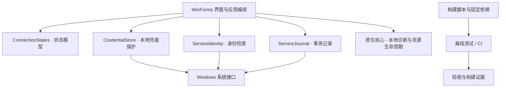

# 澈知科技 · 校园网连接

**campus-network-auth — Windows 桌面网络连接状态管理与诊断工具**


> **开发候选版（RC），尚未达到正式发布条件。** 项目包含第三方认证核心，须遵守学校网络管理规定及服务商使用条款。仅限本人有权使用的账号和获准环境；不得用于绕过网络访问控制、设备限制或计费策略。优先使用学校提供的官方客户端与官方支持渠道。

## 快速导航

[项目简介](#1-项目简介) · [技术架构](#2-平台与技术架构) · [仓库导航](#3-仓库导航) · [安全边界](#4-安全隐私与授权边界) · [开发与构建](#5-开发与构建说明) · [验收进度](#6-开发进度与验收证据) · [测试管理](#7-测试与质量管理) · [故障反馈](#8-故障反馈与退出清理) · [许可](#9-许可与第三方组件)

## 1. 项目简介

项目采用 C# / WinForms 桌面界面及 C 原生核心，围绕连接状态展示、本地诊断、凭据保护、资源生命周期和构建安全开展工程整改。现阶段以可审计、可回归、故障可定位为目标，而非扩大网络接入权限。

主要设计目标：

- **状态明确**：区分操作进行中、连接观察、失败、状态未知及恢复责任未解除等情况。
- **本地安全**：凭据存储采用 DPAPI CurrentUser 与文件访问控制；显式保存和清除，避免默默覆盖未知或损坏的数据。
- **资源有界**：检查缓冲区容量、内存分配与异常释放；采用受控生命周期管理。
- **可追溯构建**：依赖固定版本、源码归档摘要校验、构建产物清单与源码级 SBOM。
- **审计优先**：离线测试、CI 实际日志及发布验收分别记录，失败时保留原因，不将未验证状态解释为成功。

### 1.1 功能与验收矩阵

| 能力 | 当前工程状态 | 验收限制 |
| --- | --- | --- |
| 窗口与托盘生命周期 | 已有 100 轮离线回归 | 不代替真实桌面长跑 |
| 界面布局与连接状态展示 | 已有 UI 回归及状态模型 | 真实显示缩放、环境变化待验证 |
| 本地凭据存储保护 | 已实现既有 DPAPI / ACL 设计 | 不等同于端到端安全 |
| 本地网卡与流量诊断 | 三平台指定资源回归通过 | 不代表完整客户端跨平台 |
| 系统状态与恢复责任记录 | 已有身份和事务模块 | 真实系统操作验收延期 |
| 发布包与依赖审计 | 已有清单、版本锁和 CI | 正式发布仍受阻 |

## 2. 平台与技术架构

| 层级 | 技术 / 组件 | 说明 |
| --- | --- | --- |
| 桌面界面 | C#、WinForms、.NET Framework 4.x | UI、状态显示及本地诊断 |
| 原生核心 | C、ESurfingClient-CVersion 衍生代码 | 既有网络组件；当前产品目标为 Windows |
| 传输库 | libcurl 8.23.0、Schannel | 固定源码归档；Schannel 不会自动使明文 HTTP 成为 HTTPS |
| JSON | cJSON 1.7.19（本地修订） | 本地版本锁及边界回归；公告适用性仍需核查 |
| 凭据保护 | Windows DPAPI、ACL | 不等于能够抵御同用户恶意代码或内存取证 |
| 构建与验证 | PowerShell、CMake、Ninja、MinGW-w64、GitHub Actions | 构建清单、资源回归和供应链检查 |

Linux 与 macOS 仅提供部分离线原生测试的 CI 覆盖，**不表示完整桌面客户端支持这两个系统**。

### 2.1 本地模块关系

以下为职责概览，不是网络认证协议、接入配置或系统服务操作流程。



### 2.2 模块职责与边界

| 模块 | 主要职责 | 审计重点 |
| --- | --- | --- |
| ConnectionStates.cs | 领域状态、迁移与展示映射 | 状态来源、过期观察、未知状态 |
| CredentialStore.cs | 本地凭据的显式存储与清除 | 数据所有权、文件权限、失败保护 |
| ServiceIdentity.cs | 系统服务身份检查 | 身份证据、不确定状态 |
| ServiceJournal.cs | 操作事务及恢复责任记录 | 持久化一致性、未完成事务 |
| Program.cs | 界面、托盘、应用协调 | 布局、消息循环、操作生命周期 |
| 原生本地资源模块 | 网卡枚举、采样及快照 | 容量上限、分配失败、释放与并发 |
| scripts/ | 构建和验收工具 | 依赖锁、证据完整性、失败门禁 |

上述模块已存在于源码树。Program.cs 的完整职责拆分仍属于后续计划，不宣称已完成全部模块化。

详细设计见 [ARCHITECTURE.md](ARCHITECTURE.md)。

## 3. 仓库导航

| 路径 | 用途 |
| --- | --- |
| Program.cs | 桌面界面及应用协调逻辑 |
| CredentialStore.cs | 本地凭据存储 |
| ConnectionStates.cs | 领域状态与展示模型 |
| ServiceIdentity.cs / ServiceJournal.cs | 身份检查及事务记录 |
| 认证核心源码/ | 原生核心与随仓库携带的组件 |
| Build-Core.ps1 / Build.ps1 | 源码及桌面构建脚本 |
| scripts/ | 构建依赖核验、测试、清单生成等工具 |
| scripts/tests/ | 独立合成资源故障测试 |
| .github/workflows/build.yml | 持续集成任务 |
| FINAL_AUDIT.md | 五大专项验收证据及限制 |
| RELEASE_CHECKLIST.md | 正式发布条件 |

## 4. 安全、隐私与授权边界

- **上游协议限制（UPSTREAM_LIMITATION）**：既有认证协议使用明文 HTTP，不能保证服务器身份与传输机密性。请勿复用校园网密码；优先使用官方支持的安全连接方式。
- 本地加密存储不能替代传输加密。托管字符串、换页、崩溃转储及强制退出时的内存残留无法保证彻底擦除。
- SHA-256 校验用于发现文件不一致，不等同于 Authenticode 签名或独立构建来源证明；当前没有代码签名证书。
- 网络状态显示仅作为诊断信息，不等同于服务端授权结论。不要依赖未知或过期的状态作出权限判断。
- 诊断设计以本地脱敏为目标；分享日志前仍应自行检查账号、地址及其他个人信息。未经完整独立审计，不承诺绝无数据外泄。
- 不关闭系统安全防护，不强制结束不属于本程序的进程，不修改学校网络访问控制规则。涉及系统服务的变更须取得明确授权。

详见 [SECURITY.md](SECURITY.md)。

## 5. 开发与构建说明

开发目标环境为 Windows 10/11 x64。构建依赖包括 .NET Framework C# 编译器、CMake、Ninja、同一工具链的 MinGW-w64 GCC/G++ 以及 tar.exe。源码构建不需要提供真实校园网凭据；离线自测不执行真实认证。

构建配置、依赖缓存、输出目录、覆盖保护及产物清单见 [从源码构建.md](从源码构建.md)。构建成功仅表示编译和对应门禁通过，并不代表正式发布或真实网络功能验收成功。

产物证据包括 build-manifest.json、源码级 sbom.cdx.json、PE 直接导入报告及构建证据索引（具体生成范围以当次 CI 为准）。源码 SBOM 不是完整二进制或操作系统组件清单；新的标准 incomplete 组成声明和语义验证尚待 CI 成功验证。

## 6. 开发进度与验收证据

**状态快照：2026-11-26，提交 6098ff6，CI #376。** 此快照描述该历史提交，不自动代表 README 后续提交或当前 HEAD。实时结果请查看 [GitHub Actions](https://github.com/ljjnb666-nb/campus-network-auth/actions) 与 [开发 PR #1](https://github.com/ljjnb666-nb/campus-network-auth/pull/1)。

| 验收项 | CI #376 实际结果 |
| --- | --- |
| Windows 本地资源场景 | 22 项通过 |
| Linux 网卡扩容及 JSON 分配失败 | 6 + 22 项通过 |
| Linux 流量快照实际分配失败 | 36 项通过 |
| macOS 合成缓冲区场景 | 12 项通过 |
| Windows 原生资源自测 | 通过 |
| 应用生命周期离线回归 | 100 轮通过 |
| UI 消息循环压力回归 | 100 轮通过 |
| 敏感信息扫描器自测 | 4 项通过 |
| 仓库正式敏感信息扫描 | **失败，未关闭** |
| CI 整体 | **失败（Windows）；Linux/macOS 成功** |

[CI #376 原始记录](https://github.com/ljjnb666-nb/campus-network-auth/actions/runs/45754822966)

Linux 的 64 个实际分配失败位置与 Windows/macOS 的 34 个合成场景具有不同含义，不能合称 98 个实际分配失败位置。上述短期离线回归不证明长期无泄漏，也不证明真实网络功能可用。

### 五大专项

| 专项 | 当前开发状态 |
| --- | --- |
| 原生网络内存与资源管理 | 本地网卡与流量离线范围已通过；其余路径仍有审计缺口 |
| 原生并发网络探测 | 既有离线回归；未完成集中验收 |
| 原生线程退出及看门狗 | 既有生命周期回归；未完成集中验收 |
| 加密中间缓冲清理 | 指定离线门禁历史通过；不保证所有副本擦除 |
| 构建供应链安全 | 正在整改；扫描、SBOM 语义、公告适用性及独立复现仍有阻断 |

### 验收口径

- LOCAL_ADAPTER_AND_TRAFFIC_OFFLINE_VERIFIED：已定义的本地资源离线子阶段通过。
- DEFERRED_REAL_ENV：真实环境测试延期，并非通过。
- FULL_RELEASE_ACCEPTANCE_BLOCKED：正式发布条件尚未满足。

实机网络、网卡热插拔、UAC、客户端恢复、多档 DPI、升级与卸载、24/72 小时长期运行均延后至获准环境；当前不阻断其他离线开发，但仍是发布验收条件。

## 7. 测试与质量管理

采用宏观分阶段、微观小步提交、专项统一验收的方式。测试应覆盖正常、异常、边界、并发与资源清理；每次验收绑定实际提交 SHA 和 CI 结果。

- 离线测试说明：[TESTING.md](TESTING.md)
- 五大专项及历史基线：[FINAL_AUDIT.md](FINAL_AUDIT.md)
- 第三方组件与公告：[THIRD_PARTY_NOTICES.md](THIRD_PARTY_NOTICES.md)
- 发布检查：[RELEASE_CHECKLIST.md](RELEASE_CHECKLIST.md)

不为获取绿色 CI 而删除测试、降低门禁或掩盖未完成项。项目当前保留 Draft PR，未经审核不合并、不正式发布。

### 7.1 质量证据的判读顺序


| 证据 | 可以证明 | 不能单独证明 |
| --- | --- | --- |
| Git 提交 | 变更已进入指定分支 | 运行正确或无漏洞 |
| CI 单项通过 | 指定提交的该项门禁通过 | 其他未执行任务通过 |
| 整体 CI 通过 | 配置内各强制任务通过 | 完整安全性及真实接入可用 |
| 同 runner 哈希相同 | 指定产物在该环境重复构建一致 | 独立环境复现或签名可信 |
| 专项离线验收 | 定义的离线范围闭合 | 延期实机条件已满足 |

任何正式发布均需独立复核 [RELEASE_CHECKLIST.md](RELEASE_CHECKLIST.md)。CI #376 的正式扫描仍失败，后续 SBOM 新语义门禁不能据此宣称通过。

## 8. 故障反馈与退出清理

遇到界面状态不一致、恢复操作失败或残留进程，请优先保留现状并记录 Windows 版本、应用版本、操作时间、界面状态及已脱敏诊断。无法确认系统服务状态时，请通过官方客户端或学校 IT 支持处理，不执行未经授权的服务操作。

卸载前应先正常退出本程序，确认没有待恢复的服务事务，再仅清理明确属于本程序且已确认无需保留的文件。不要通配删除临时目录或整个共享应用数据目录；不确定时保留数据并联系管理员。

漏洞报告请采用仓库所有者提供的私密渠道，不在公开 Issue 中粘贴真实凭据、认证报文或敏感日志。

### 8.1 问题反馈模板

```text
问题标题：
Windows 版本与显示缩放：
应用版本 / 提交 SHA（如已知）：
问题发生时间：
操作前的界面状态：
观察到的异常：
预期结果：
能否稳定复现：
脱敏截图或日志：
```

不要附带真实账号、密码、认证报文、令牌、未经脱敏的网络标识或其他个人信息。问题反馈不需要主动触发真实认证或改变系统服务状态。

## 9. 许可与第三方组件

- 原生核心衍生自 [ESurfingClient-CVersion](https://github.com/BadGhost520/ESurfingClient-CVersion)，Apache-2.0；保留适用版权和许可声明。
- libcurl、cJSON 的许可及本地修订记录见 [THIRD_PARTY_NOTICES.md](THIRD_PARTY_NOTICES.md)。
- 桌面界面源码暂未附许可声明，不应视为已授权对外分发。
- 当前版本未取得代码签名、完整供应链来源证明及正式发布验收。
