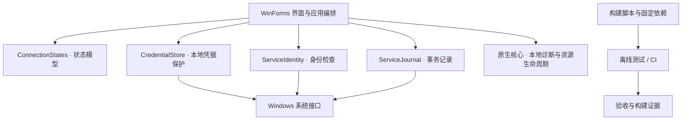

# 澈知科技 · 校园网连接

**campus-network-auth — Windows 桌面网络连接状态管理与诊断工具**


> **开发候选版（RC），尚未达到正式发布条件。** 项目包含第三方认证核心，须遵守学校网络管理规定及服务商使用条款。仅限本人有权使用的账号和获准环境；不得用于绕过网络访问控制、设备限制或计费策略。优先使用学校提供的官方客户端与官方支持渠道。

## 快速导航

[项目简介](#1-项目简介) · [技术架构](#2-平台与技术架构) · [仓库导航](#3-仓库导航) · [安全边界](#4-安全隐私与授权边界) · [开发与构建](#5-开发与构建说明) · [验收进度](#6-开发进度与验收证据) · [测试管理](#7-测试与质量管理) · [故障反馈](#8-故障反馈与退出清理) · [许可](#9-许可与第三方组件)

## 1. 项目简介

项目采用 C# / WinForms 桌面界面及 C 原生核心，围绕连接状态展示、本地诊断、凭据保护、资源生命周期和构建安全开展工程整改。现阶段以可审计、可回归、故障可定位为目标，而非扩大网络接入权限。

主要设计目标：

- **状态明确**：区分操作进行中、连接观察、失败、状态未知及恢复责任未解除等情况。
- **本地安全**：凭据存储采用 DPAPI CurrentUser 与文件访问控制；显式保存和清除，避免默默覆盖未知或损坏的数据。
- **资源有界**：检查缓冲区容量、内存分配与异常释放；采用受控生命周期管理。
- **可追溯构建**：依赖固定版本、源码归档摘要校验、构建产物清单与源码级 SBOM。
- **审计优先**：离线测试、CI 实际日志及发布验收分别记录，失败时保留原因，不将未验证状态解释为成功。

### 1.1 功能与验收矩阵

| 能力 | 当前工程状态 | 验收限制 |
| --- | --- | --- |
| 窗口与托盘生命周期 | 已有 100 轮离线回归 | 不代替真实桌面长跑 |
| 界面布局与连接状态展示 | 已有 UI 回归及状态模型 | 真实显示缩放、环境变化待验证 |
| 本地凭据存储保护 | 已实现既有 DPAPI / ACL 设计 | 不等同于端到端安全 |
| 本地网卡与流量诊断 | 三平台指定资源回归通过 | 不代表完整客户端跨平台 |
| 系统状态与恢复责任记录 | 已有身份和事务模块 | 真实系统操作验收延期 |
| 发布包与依赖审计 | 已有清单、版本锁和 CI | 正式发布仍受阻 |

## 2. 平台与技术架构

| 层级 | 技术 / 组件 | 说明 |
| --- | --- | --- |
| 桌面界面 | C#、WinForms、.NET Framework 4.x | UI、状态显示及本地诊断 |
| 原生核心 | C、ESurfingClient-CVersion 衍生代码 | 既有网络组件；当前产品目标为 Windows |
| 传输库 | libcurl 8.23.0、Schannel | 固定源码归档；Schannel 不会自动使明文 HTTP 成为 HTTPS |
| JSON | cJSON 1.7.19（本地修订） | 本地版本锁及边界回归；公告适用性仍需核查 |
| 凭据保护 | Windows DPAPI、ACL | 不等于能够抵御同用户恶意代码或内存取证 |
| 构建与验证 | PowerShell、CMake、Ninja、MinGW-w64、GitHub Actions | 构建清单、资源回归和供应链检查 |

Linux 与 macOS 仅提供部分离线原生测试的 CI 覆盖，**不表示完整桌面客户端支持这两个系统**。

### 2.1 本地模块关系

以下为职责概览，不是网络认证协议、接入配置或系统服务操作流程。



### 2.2 模块职责与边界

| 模块 | 主要职责 | 审计重点 |
| --- | --- | --- |
| ConnectionStates.cs | 领域状态、迁移与展示映射 | 状态来源、过期观察、未知状态 |
| CredentialStore.cs | 本地凭据的显式存储与清除 | 数据所有权、文件权限、失败保护 |
| ServiceIdentity.cs | 系统服务身份检查 | 身份证据、不确定状态 |
| ServiceJournal.cs | 操作事务及恢复责任记录 | 持久化一致性、未完成事务 |
| Program.cs | 界面、托盘、应用协调 | 布局、消息循环、操作生命周期 |
| 原生本地资源模块 | 网卡枚举、采样及快照 | 容量上限、分配失败、释放与并发 |
| scripts/ | 构建和验收工具 | 依赖锁、证据完整性、失败门禁 |

上述模块已存在于源码树。Program.cs 的完整职责拆分仍属于后续计划，不宣称已完成全部模块化。

详细设计见 [ARCHITECTURE.md](ARCHITECTURE.md)。

## 3. 仓库导航

| 路径 | 用途 |
| --- | --- |
| Program.cs | 桌面界面及应用协调逻辑 |
| CredentialStore.cs | 本地凭据存储 |
| ConnectionStates.cs | 领域状态与展示模型 |
| ServiceIdentity.cs / ServiceJournal.cs | 身份检查及事务记录 |
| 认证核心源码/ | 原生核心与随仓库携带的组件 |
| Build-Core.ps1 / Build.ps1 | 源码及桌面构建脚本 |
| scripts/ | 构建依赖核验、测试、清单生成等工具 |
| scripts/tests/ | 独立合成资源故障测试 |
| .github/workflows/build.yml | 持续集成任务 |
| FINAL_AUDIT.md | 五大专项验收证据及限制 |
| RELEASE_CHECKLIST.md | 正式发布条件 |

## 4. 安全、隐私与授权边界

- **上游协议限制（UPSTREAM_LIMITATION）**：既有认证协议使用明文 HTTP，不能保证服务器身份与传输机密性。请勿复用校园网密码；优先使用官方支持的安全连接方式。
- 本地加密存储不能替代传输加密。托管字符串、换页、崩溃转储及强制退出时的内存残留无法保证彻底擦除。
- SHA-256 校验用于发现文件不一致，不等同于 Authenticode 签名或独立构建来源证明；当前没有代码签名证书。
- 网络状态显示仅作为诊断信息，不等同于服务端授权结论。不要依赖未知或过期的状态作出权限判断。
- 诊断设计以本地脱敏为目标；分享日志前仍应自行检查账号、地址及其他个人信息。未经完整独立审计，不承诺绝无数据外泄。
- 不关闭系统安全防护，不强制结束不属于本程序的进程，不修改学校网络访问控制规则。涉及系统服务的变更须取得明确授权。

详见 [SECURITY.md](SECURITY.md)。

## 5. 开发与构建说明

开发目标环境为 Windows 10/11 x64。构建依赖包括 .NET Framework C# 编译器、CMake、Ninja、同一工具链的 MinGW-w64 GCC/G++ 以及 tar.exe。源码构建不需要提供真实校园网凭据；离线自测不执行真实认证。

构建配置、依赖缓存、输出目录、覆盖保护及产物清单见 [从源码构建.md](从源码构建.md)。构建成功仅表示编译和对应门禁通过，并不代表正式发布或真实网络功能验收成功。

产物证据包括 build-manifest.json、源码级 sbom.cdx.json、PE 直接导入报告及构建证据索引（具体生成范围以当次 CI 为准）。源码 SBOM 不是完整二进制或操作系统组件清单；标准 incomplete 组成声明及定义的语义验证已在冻结基线 CI #443 通过，实际完整链接组成仍待核验。

## 6. 开发进度与验收证据

**当前内部 RC 冻结基线：2026-11-26，分支提交 `716ab3193bf26c2d2ad34fad5e07e8220be4b121`，CI #443。** 这是指定提交的离线验收状态，不代表正式发布或真实校园网功能已经验收。

### 6.1 最新 CI 与内部归档

- [CI #443](https://github.com/ljjnb666-nb/campus-network-auth/actions/runs/45780131488)：Windows 构建/测试、Linux 安全审计、macOS 资源审计、SBOM 审计共 **4/4 jobs 成功**。
- Roslyn 候选 GUI 在同一 runner 两次完整编译字节一致；随后实际执行既有离线自测 **11/11 通过**（logic、credentials、core、native-input、native-net、stop、resources、ui、app-lifecycle、ui-stress、signature）。这证明定义的候选离线测试通过，不等于默认构建工具链已经迁移。
- 候选 GUI 的两次构建大小均为 1,394,176 字节，SHA-256 均为 `30C9E8CB8349E7D9EF249666E990530A4740D40AD1244132042F9D1B82A6FFB4`。候选 EXE 不包含在内部 RC 归档中，不能将其当作当前发布产物。
- 内部归档 artifact ID `15098745397`，ZIP 1,281,572 bytes，SHA-256 `8b72eee0dba9e385350e8e619e499e14592812e97902d203e68d7b6cc5a812a9`。独立下载核验：14 个唯一文件、CRC 通过、证据索引 13/13、构建产物摘要 3/3 一致。该归档未签名。
- PR #1 仍为 Draft；main 未修改。最新验证只适用于上述冻结提交及其对应 CI。

### 6.2 已通过的定义离线范围

| 范围 | 证据 | 限制 |
| --- | --- | --- |
| 状态机与操作权限 | 256 组合矩阵、事务结果及生命周期回归 | 不等于真实服务操作 |
| UI 布局与滚动 | 36 组布局、715 次滚动可达性、100 轮压力 | 不等于真实多屏 DPI 或长跑 |
| 应用与核心生命周期 | 100 轮离线生命周期、STOP/管道排空 | 不等于真实校园网会话 |
| 本地凭据与事务记录 | DPAPI/ACL、有界读取、损坏/锁定场景 | 不抵御同用户恶意代码或所有祖先路径竞争 |
| 原生资源与网络缓冲 | 指定平台合成故障、快照分配失败及释放回归 | 不是全部原生路径的完整证明 |
| 加密中间缓冲 | 指定算法向量、优化擦除探针及 sanitizer 门禁 | 不保证第三方副本、托管字符串、寄存器、换页和崩溃转储完全擦除 |
| Roslyn 候选兼容性 | 双编译字节一致、11/11 离线自测 | 同 runner 观察，不是独立来源锁或跨环境复现 |
| 构建归档完整性 | ZIP、CRC、证据索引和产物摘要独立核对 | SHA-256 不等于数字签名或来源信任 |

### 6.3 安全与发布阻断

- 上游认证协议使用明文 HTTP，客户端不能单方面提供服务器身份验证或传输机密性；请勿复用校园网密码。
- cJSON 1.7.19 六项公开公告已完成初步源码适用性分类；32 位边界和最终二进制可达性仍需独立验证。详见 [THIRD_PARTY_NOTICES.md](THIRD_PARTY_NOTICES.md)。
- 构建依赖版本锁包含 20 项包，但实际安装包归档字节/签名未全部独立核验；静态链接组成及其许可义务仍待 link map、归档成员和来源证据。
- 当前默认 GUI 仍使用 .NET Framework csc；Roslyn 是隔离候选，尚未切换默认构建。
- 桌面源码许可、代码签名证书、独立 Windows 环境复现、升级/卸载、真实环境、DPI、服务交接及 24/72 小时长跑仍未完成。
- 正式敏感信息扫描在 CI #443 的指定提交中通过，但扫描器是启发式工具，不证明整个 Git 历史、所有文件类型或所有秘密形式均无泄漏。

当前结论：`INTERNAL_RC_BASELINE_FROZEN`；`ROSLYN_DEFINED_OFFLINE_SUITE_VERIFIED`；`FULL_RELEASE_ACCEPTANCE_BLOCKED`。详细证据及 Codex 最终任务见 [FINAL_AUDIT.md](FINAL_AUDIT.md)、[RELEASE_CHECKLIST.md](RELEASE_CHECKLIST.md) 和 [CODEX_HANDOFF.md](CODEX_HANDOFF.md)。

## 7. 测试与质量管理

测试按“源码变更 → 静态检查 → 离线测试 → CI 实际日志 → 独立复审 → 获准实机验收 → 人工发布审批”逐层判读。Git 提交、CI 绿色、同 runner 哈希一致、内部归档核验分别只能证明其明确定义的范围，不能互相替代。

- 离线入口及 11 项 Roslyn 候选测试：[TESTING.md](TESTING.md)。
- 五大专项与历史基线：[FINAL_AUDIT.md](FINAL_AUDIT.md)。
- 第三方组件、公开公告及许可状态：[THIRD_PARTY_NOTICES.md](THIRD_PARTY_NOTICES.md)。
- 正式发布门禁：[RELEASE_CHECKLIST.md](RELEASE_CHECKLIST.md)。

不为获取绿色 CI 删除测试、降低门禁或把未执行事项标记为通过。项目保持 Draft，未经人工审核和用户授权不合并、不正式发布。

## 8. 故障反馈与退出清理

遇到界面状态不一致、恢复操作失败或残留进程，请优先保留现状并记录 Windows 版本、应用版本、操作时间、界面状态及已脱敏诊断。无法确认系统服务状态时，请通过官方客户端或学校 IT 支持处理，不执行未经授权的服务操作。

卸载前应先正常退出本程序，确认没有待恢复的服务事务，再仅清理明确属于本程序且已确认无需保留的文件。不要通配删除临时目录或整个共享应用数据目录；不确定时保留数据并联系管理员。

漏洞报告请采用仓库所有者提供的私密渠道，不在公开 Issue 中粘贴真实凭据、认证报文或敏感日志。

### 8.1 问题反馈模板

```text
问题标题：
Windows 版本与显示缩放：
应用版本 / 提交 SHA（如已知）：
问题发生时间：
操作前的界面状态：
观察到的异常：
预期结果：
能否稳定复现：
脱敏截图或日志：
```

不要附带真实账号、密码、认证报文、令牌、未经脱敏的网络标识或其他个人信息。问题反馈不需要主动触发真实认证或改变系统服务状态。

## 9. 许可与第三方组件

- 原生核心衍生自 [ESurfingClient-CVersion](https://github.com/BadGhost520/ESurfingClient-CVersion)，Apache-2.0；保留适用版权和许可声明。
- libcurl、cJSON 的许可及本地修订记录见 [THIRD_PARTY_NOTICES.md](THIRD_PARTY_NOTICES.md)。
- 桌面界面源码暂未附许可声明，不应视为已授权对外分发。
- 当前版本未取得代码签名、完整供应链来源证明及正式发布验收。
